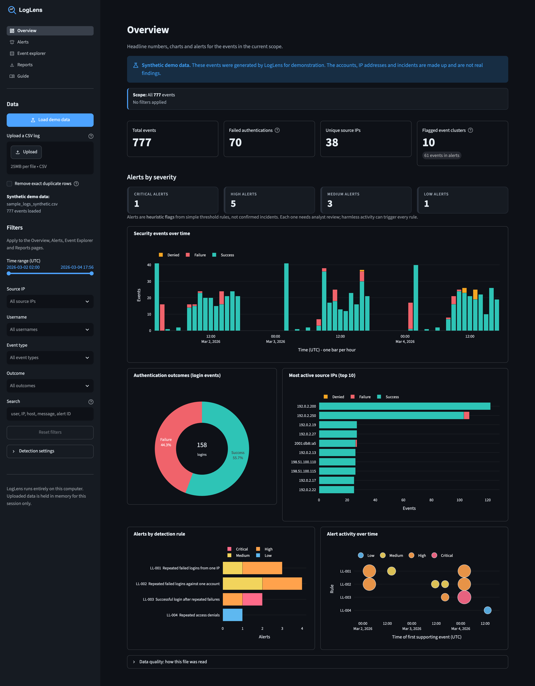
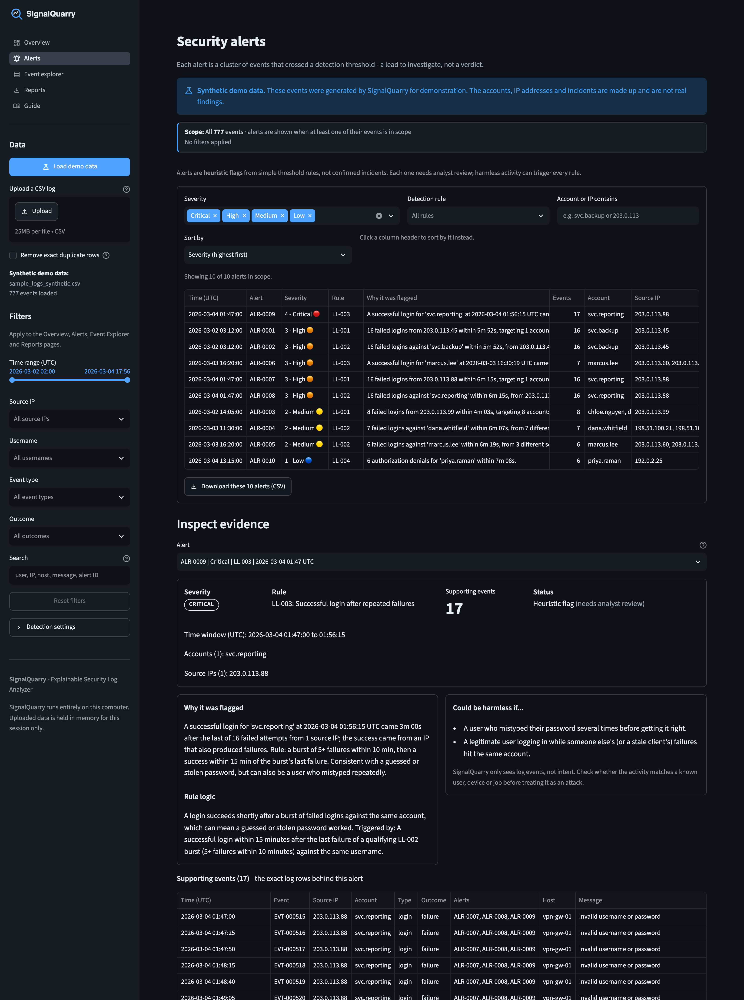
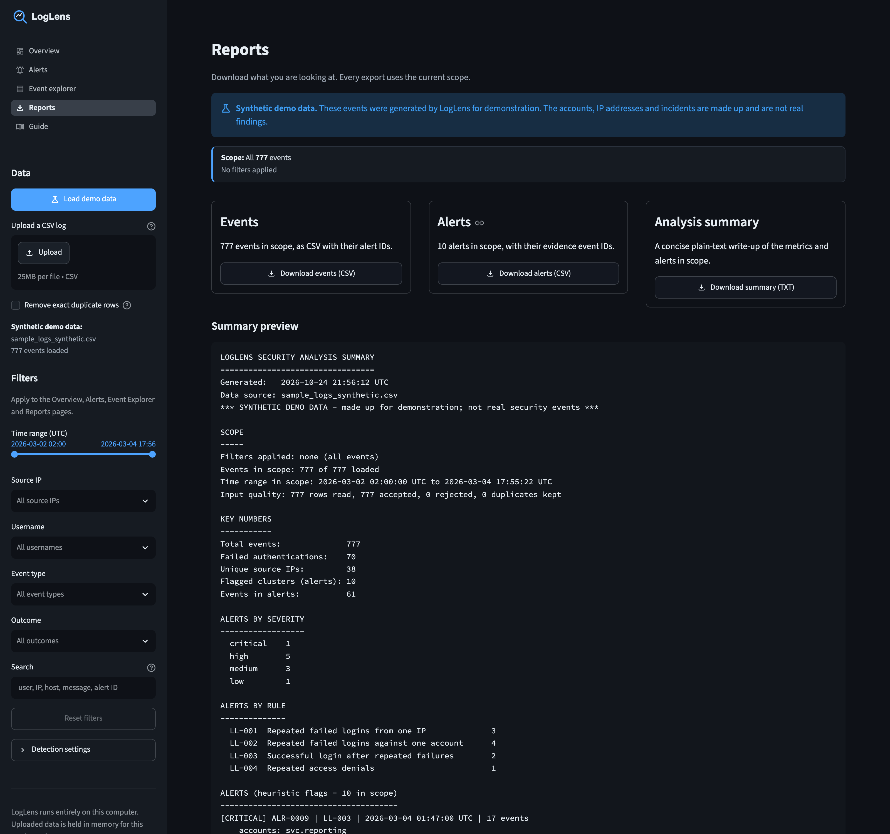

# LogLens - Security Log Analyzer

LogLens is a **local** security log analyzer. Upload a CSV of authentication and access events,
and LogLens validates it, runs four explainable detection rules, and shows you what was flagged,
**why**, and which exact log rows are the evidence. It runs entirely on your computer: no
accounts, no cloud, no paid services.

> **All security data in this repository is synthetic.** The bundled sample
> (`data/sample_logs_synthetic.csv`) was generated by `loglens/sample_data.py` with made-up
> usernames and IP addresses from the ranges reserved for documentation (RFC 5737 / RFC 3849).
> None of it is a real incident, and the app labels it as synthetic wherever it is shown.

## Screenshots

All three were captured from the running app with the bundled **synthetic** demo data (777 made-up
events, 10 expected alerts). No real logs appear anywhere in this repository.

**Overview** - headline numbers, severity counts and five charts for the current scope:



**Alerts and evidence** - the alert table, and the inspector for one alert: why the rule fired,
harmless explanations, and the exact log rows behind it:



**Reports** - CSV exports and a plain-text summary that always match the current filters:



## The problem it addresses

Security logs are long, noisy and written for machines. A person reviewing them has to answer
questions like *"is someone guessing passwords?"* or *"did a login succeed right after a burst of
failures?"* LogLens turns those questions into simple, transparent rules over rolling time
windows, then shows the evidence next to each answer so the analyst can decide. It is a learning
and triage tool, not a replacement for a SIEM.

## Features

- **Reliable CSV ingestion** with a documented schema, UTC time normalization, and a
  data-quality report. Invalid rows are rejected *and reported* (row number, column, reason),
  never silently dropped.
- **Four detection rules** (LL-001 to LL-004) with configurable thresholds and windows. Alerts
  are clusters, not one alert per event, and results do not depend on row order.
- **Dashboard** (dark, security-operations style): overview metrics, five interactive charts,
  a sortable and filterable alert table, an evidence inspector for every alert, and an event
  explorer with date/time, IP, username, event-type, outcome and text filters.
- **Exports**: filtered events (CSV), alerts (CSV), and a concise plain-text analysis summary.
  CSV exports are protected against spreadsheet formula injection.
- **Demo mode**: one click loads a deterministic synthetic dataset with documented scenarios,
  including benign high-activity periods that must *not* alert.
- **Independent evaluation**: a second synthetic dataset (`evaluation/`) with 45 scripted
  positive, boundary, negative and known-blind-spot cases and a scorer that reports false
  positives and missed detections. Results are in [Evaluation](#evaluation).
- **Honest by design**: every alert is a *heuristic flag*, never a "confirmed incident", and each
  one lists harmless explanations next to the suspicious one.

## Technology stack

Python 3.11+ · [Streamlit](https://streamlit.io) (UI) · pandas (processing) ·
[Plotly](https://plotly.com/python/) (charts) · pytest (tests) · Ruff (lint/format).
No database, no authentication service, no external API.

Developed and tested on **macOS with Python 3.13.5**, Streamlit 1.66, pandas 3.1, Plotly 7.1,
pytest 9.1, Ruff 0.17. The Windows steps below use standard Python tooling but have **not been
run on a Windows machine**.

## What LogLens can and cannot detect

**It flags these patterns** (defaults; all thresholds are configurable):

| Pattern | Rule |
|---|---|
| 5+ failed logins from one source IP within 10 minutes (guessing, spraying) | LL-001 |
| 5+ failed logins against one account within 10 minutes, from any IPs | LL-002 |
| A successful login within 15 minutes after the last failure of such a burst | LL-003 |
| 4+ events with outcome `denied` for one account within 10 minutes | LL-004 |

It copes with unsorted rows, mixed time-zone offsets, upper/lower-case account names, IPv6 and
IPv4-mapped addresses, identical timestamps, and sustained attacks (one alert per cluster, not
one per event).

**It does not detect these** (each is demonstrated by a case in the [evaluation](#evaluation) or
follows from the design):

- *Low-and-slow* guessing that never puts 5 failures in 10 minutes.
- *Distributed* attacks in which no single IP and no single account crosses a threshold.
- One identity written several ways (`alice`, `alice@example.com`, `CORP\alice`).
- A success after an IP-level *spray*: LL-003 correlates per account, so a spray that touches
  each account once never forms a burst for it.
- Anything outside the four event types and three outcomes of the schema: no geolocation or
  impossible travel, MFA fatigue, privilege escalation, lateral movement, data exfiltration,
  malware, or network and endpoint telemetry. It reads one CSV; there are no other log formats.
- Whether activity is legitimate. There is no allow-list and no knowledge of your environment, so
  shared NAT addresses, lockouts and noisy service accounts raise alerts (or hide attacks).

Every alert is a *heuristic flag* for a person to review, never a verdict.

## Install and run

**Prerequisite: Python 3.11 or newer** (the minimum that pandas 3 and Streamlit support; only
3.13 has actually been tested, see [Continuous integration](#continuous-integration)). Check
with `python3 --version` (Windows: `py -3 --version`).
The Python that ships with macOS (`/usr/bin/python3`, version 3.9) is too old: installing there
fails with a long `No matching distribution found for streamlit` error. If you see that, install
a current Python from <https://www.python.org/downloads/> and use it in the commands below.

### macOS

```bash
cd logsecurity                      # the project folder
python3 -m venv .venv
source .venv/bin/activate
python -m pip install --upgrade pip     # the pip bundled with a new venv can be outdated
pip install -r requirements.txt
streamlit run app.py
```

### Windows (PowerShell)

```powershell
cd logsecurity
py -3 -m venv .venv
.venv\Scripts\Activate.ps1
python -m pip install --upgrade pip
pip install -r requirements.txt
streamlit run app.py
```

(If PowerShell blocks the activation script, run
`Set-ExecutionPolicy -Scope Process -ExecutionPolicy RemoteSigned` first, or use Command Prompt
and `.venv\Scripts\activate.bat`.)

**Launch command:** `streamlit run app.py` - run it from the project folder so Streamlit finds
`.streamlit/config.toml` (dark theme, 25 MB upload limit, usage statistics off, **server bound to
127.0.0.1 only**). It opens <http://localhost:8501>.

LogLens has no login. That is why the config binds it to `127.0.0.1`: only programs on your own
computer can reach it. Streamlit's own default is to listen on *every* network interface, which
would let other machines on your network open the app. Do not override `server.address` unless
you understand that anyone who can reach the port can use the app.

If you move or rename the project folder after creating `.venv`, the scripts inside `.venv/bin`
still point at the old location and `streamlit` fails with "bad interpreter". Recreate the
virtual environment, or start the app with `python -m streamlit run app.py`.

## Using LogLens

1. Open the app and click **Load demo data** (or upload your own CSV in the sidebar).
2. LogLens validates the file, converts times to UTC and runs the detections. The
   **Overview** page shows the headline numbers, charts, and a *Data quality* panel describing
   how the file was read.
3. Open **Alerts**, sort or filter the table, and pick an alert under **Inspect evidence** to
   see why it fired, the rule logic, harmless explanations, and the exact supporting events.
4. Use the sidebar **Filters** (time range, IP, username, event type, outcome, search). They
   apply to Overview, Alerts, Event explorer and Reports, and every data page states its scope
   ("Scope: 23 of 777 events match the filters"). If any detection setting differs from its
   default, the scope bar names it too.
5. Download from **Reports** (or from the table you are looking at).

Everything lives in the browser session. Reloading the page or closing the tab starts over:
load the file again. Filters survive switching pages, changing detection settings and turning
duplicate removal on or off; loading a different file resets them.

### What the demo data contains

The fixed-seed dataset has 777 events over three days. Each scripted scenario below produces
the listed alerts with the default settings; `tests/test_sample_data.py` checks that the engine
raises *exactly* these 10 alerts and nothing else.

| ID | Scenario | Expected alerts |
|----|----------|-----------------|
| S1 | 16 failed logins against `svc.backup` from one IP, no success | LL-001 high, LL-002 high |
| S2 | Password spraying: one IP, 8 accounts, one failure each | LL-001 medium only |
| S3 | 7 failures against `dana.whitfield`, each from a different IP | LL-002 medium only |
| S4 | 6 failures from 3 IPs against `marcus.lee`, then a success | LL-002 medium, LL-003 high |
| S5 | 16 failures against `svc.reporting`, then success from the same IP | LL-001 high, LL-002 high, LL-003 critical |
| S6 | 6 access denials for `priya.raman` | LL-004 low |

Benign look-alikes that must **not** alert: **B1** 20 users log in within five minutes;
**B2** a nightly ETL job makes 40 successful accesses in six minutes; **B3** four employees behind
one shared IP mistype passwords (4 failures, one below the IP threshold of 5); **B4** a user
fails three times, then logs in; **B5** an account is denied access three times (threshold 4).
Regenerate the file with `python -m loglens.sample_data`.

## Supported CSV format

One well-defined format (comma-separated, UTF-8, header row, one event per row, up to 25 MB):

| Column | Required | Meaning |
|--------|----------|---------|
| `timestamp` | yes | ISO 8601 date **and time**, e.g. `2026-03-02T14:05:09Z` or `2026-03-02T09:05:09-05:00`. Converted to UTC. Values without an offset are assumed to be UTC (and counted in the data-quality report). |
| `source_ip` | yes | IPv4 or IPv6 address, normalised: IPv6 is compressed and an IPv4-mapped address such as `::ffff:192.0.2.1` becomes `192.0.2.1`, so one host is never split across two counters. IPv6 zone IDs (`fe80::1%eth0`) are rejected: Python's `ipaddress` accepts almost any text after the `%`, which would let free text into a column that is drawn in charts. |
| `username` | yes | Account involved. Trimmed and **lower-cased** so `Alice` and `alice` are one account. Max 256 characters. Values containing control characters or invisible text-direction / zero-width characters are rejected, because they can make one account display as another (`adm` + U+202E + `nimda` displays as "admadmin"). |
| `event_type` | yes | `login`, `logout`, `access` or `password_change`. |
| `outcome` | yes | `success`, `failure` or `denied` (also accepted: `successful`, `failed`, `fail`, `deny`, `denial`). |
| `host` | no | System that recorded the event. Max 256 characters. |
| `message` | no | Free text. Messages over 2,000 characters are truncated (and counted in the data-quality report). |

Column names are case-insensitive and extra columns are ignored (and reported); repeating one of the seven columns above in the header is an error. Example:

```csv
timestamp,source_ip,username,event_type,outcome,host,message
2026-03-02T09:14:02Z,192.0.2.14,alice.morgan,login,success,sso-01,Login succeeded
2026-03-02T09:15:40Z,203.0.113.45,svc.backup,login,failure,vpn-gw-01,Invalid password
```

**Validation behaviour**

- *Whole-file errors* (empty file, header only, binary, UTF-16 or other non-UTF-8 data, missing
  required columns, duplicate headers, over the size limit) stop the load with a message saying
  what to fix. The previously loaded data is kept, and the message says so.
- *Row errors* (malformed timestamp, invalid IP or IPv6 zone ID, missing value, unsupported event
  type or outcome, control or invisible formatting characters in a username or host, over-long
  username/host, wrong number of fields) reject only that row.
  The Data quality panel lists the count per reason and the first rejected rows, using
  spreadsheet row numbers (header = row 1). Free-text values such as usernames are never quoted
  back in error messages.
- Rows may be in any order; they are sorted by timestamp and numbered `EVT-000001`... in an order
  that does not depend on the file's row order.
- **Exact duplicate rows** (identical in every field) are **kept and counted** by default, and
  the Data quality panel says so. With second-level timestamps, ten scripted guesses in one second
  are ten identical rows; removing them would hide the attack. If your source repeats log lines
  (a forwarder retry, a double export), tick **Remove exact duplicate rows** in the sidebar. The
  alert inspector also says when an alert's evidence contains duplicates. See
  [Evaluation](#evaluation) for the measured trade-off.

## Architecture

Data flows one way, and every page reads the same "scope":

```
CSV bytes
  -> parser.py        decode (UTF-8, 25 MB cap), validate each row, normalise (UTC time,
                      lower-case account, canonical IP). Bad rows are rejected AND reported.
  -> detection/       four rules run on ALL events; overlapping windows merge into one alert
                      per cluster; alerts get stable IDs (ALR-0001...) that do not depend on
                      the order of the file
  -> pipeline.py      links every event to the alerts it supports
  -> filters.py       the sidebar filters choose which events and alerts are DISPLAYED
                      (detection is never re-run on filtered data)
  -> metrics / charts / tables / reporting
                      Overview, Alerts, Event explorer and Reports are all built from that
                      one filtered scope, so their numbers cannot disagree
```

`loglens/ui/` holds the only Streamlit code (session state, sidebar, pages). Everything else is
plain Python and pandas, so the parser and the rules can be tested and reused without a browser.
The data lives in the browser session's memory only; nothing is written to disk.

## How the detections work

All rules read the events as a set and use **real timestamps**, not row counts. A rolling window
is **inclusive** at both ends: five failures spanning exactly 10:00 count for a 10-minute window,
10:01 does not. Overlapping qualifying windows are merged into **one alert per cluster**, so a
sustained burst is a single alert covering all its events, while bursts separated by more than the
window are separate alerts. The sweep is implemented once in `loglens/detection/windows.py`.

| Rule | Fires when (defaults) | Grouped by |
|------|-----------------------|------------|
| **LL-001** Repeated failed logins from one IP | 5+ failed logins within 10 min | `source_ip` (any account) |
| **LL-002** Repeated failed logins against one account | 5+ failed logins within 10 min | `username` (any IP) |
| **LL-003** Successful login after repeated failures | a successful login within 15 min after the **last failure** of a qualifying LL-002 burst | `username` |
| **LL-004** Repeated access denials | 4+ events with outcome `denied` within 10 min | `username` |

Event meanings: *failed login* = `login` + `failure`; *successful login* = `login` + `success`;
*authorization denial* = **any** event type with outcome `denied` (`access`, `password_change`,
`login`, ...). A denied login is therefore counted by LL-004, not as a failed login. If your
source marks a locked-out or blocked sign-in as `denied` and you would rather treat it as a failed
login, map it to `failure` before uploading.

**Interpretation choices.** The original brief left three points open; these are the decisions,
each easy to change in `loglens/detection/rules.py`:

- *LL-004 counts every `denied` event, not only `event_type=access`.* The brief defines the
  outcome vocabulary as success / failure / **denial** and asks for "authorization denials", so the
  `denied` outcome is the one place the data says an authorization was refused. Limiting the rule
  to `access` would silently ignore refused password changes and denied logins.
- *LL-003's 15-minute window runs from the last failure of the burst*, not from its first. The
  brief says "within a 15-minute investigation window" without saying from where; measuring from
  the start would make the window shrink as an attack got longer, so a slower attack would be
  *less* likely to be flagged.
- *Exact duplicates are kept by default* (see above).

**How LL-003 correlates events.** The link is the **username**, regardless of source IP. For
each successful login at time *s*, LogLens takes that account's failed logins **strictly
before** *s* (a failure logged in the same second as the success is not assumed to be earlier)
and finds their qualifying bursts exactly as LL-002 does. If the **last failure of a burst** is
at most 15 minutes before *s* (inclusive), the success is flagged. The window runs from the
**end** of the burst, so it does not shrink as the burst gets longer. The evidence is every burst
that ended inside the window plus the success. Several successes after the same burst are merged
into one alert. The alert states whether the success came from an IP that also produced failures,
and the severity logic does not treat either case as proof.

**Severity.** Each rule has a base severity, raised one level when the cluster has at least
3 times the threshold in events:

| Rule | Base | Raised to |
|------|------|-----------|
| LL-001, LL-002 | medium | high at 15+ events |
| LL-003 | high | critical at 15+ failures |
| LL-004 | low | medium at 12+ denials |

**Heuristic flags, not incidents.** Every alert carries the classification *Heuristic flag*. The
explanation names the rule that fired, says what the pattern is *consistent with*, and lists
harmless causes. Different rules can flag the same events (a single IP hammering a single account
satisfies both LL-001 and LL-002); within one rule a cluster is never reported twice.

**Scope of a filter.** Detection always runs on the **full** loaded dataset (filtering first would
break correlations such as "success after failures"). Filters only select what is displayed. An
alert is "in scope" when at least one of its supporting events passes the filters, and the same
definition drives the metrics, charts, tables, exports and summary.

## Adjusting thresholds

In the app, open **Detection settings** in the sidebar: changing a number re-runs detection on
the loaded data, and **Restore defaults** resets them. In code:

```python
from loglens.detection import DetectionConfig, run_detections
from loglens.parser import parse_csv

events = parse_csv(open("my_logs.csv", "rb").read()).events
config = DetectionConfig(
    ip_failure_threshold=3,  # LL-001 count
    ip_failure_window_minutes=5,  # LL-001 window
    account_failure_threshold=4,  # LL-002 and the LL-003 burst
    success_investigation_minutes=30,
    denial_threshold=3,
)
alerts = run_detections(events, config)
```

Defaults and validation (thresholds >= 2, windows >= 1 minute) live in
`loglens/detection/config.py`. Try lowering the IP threshold to 4 on the demo data: the
shared-NAT scenario (B3) starts alerting, which shows how thresholds trade missed attacks against
false positives.

## Evaluation

`evaluation/` holds a second synthetic dataset, built **independently of the demo generator**:
different accounts, addresses and dates, and expected alerts written by hand from the documented
rules (not copied from LogLens output). It has 1,875 rows: 45 scripted cases (23 positive, 4
boundary, 14 negative, 4 known-limitation cases) plus a week of routine traffic that cannot reach any
threshold. Each case owns its accounts and addresses, so every alert can be attributed.

```bash
python -m evaluation.run_evaluation            # score LogLens and print the report
python -m evaluation.run_evaluation --write    # also refresh evaluation/RESULTS.md
python -m evaluation.build_evaluation_data     # regenerate the CSV and ground truth
```

What the columns mean (every run reconciles: expected = matched + missed, and
generated = matched + unexpected):

- **Expected** - alerts the hand-written ground truth requires.
- **Generated** - every alert LogLens raised, wanted or not.
- **Matched** - generated alerts that are expected (same rule, same IP or account).
- **Missed** - expected alerts LogLens did not raise.
- **Unexpected** - generated alerts that were not expected (false positives).

| Run | Expected | Generated | Matched | Missed | Unexpected |
|---|---|---|---|---|---|
| Duplicates **kept** (default) | 41 | 43 | 41 | 0 | 2 |
| Duplicates **removed** | 41 | 39 | 39 | 2 | 0 |

Read the first row as: LogLens raised 43 alerts, 41 of them were the expected ones, none of the
expected alerts was missed, and 2 were unexpected (41 = 41 + 0 and 43 = 41 + 2). Every matched
alert also had the expected severity and evidence count (41 of 41, and 39 of 39 in the second run).
Precision (matched / generated) is 95.3% and recall (matched / expected) is 100.0% in the first
run, 100.0% and 95.1% in the second.

The four known-limitation cases contain five documented blind spots. They are not counted as expected alerts; the check is that they stay
silent, and they did in both runs (5 of 5). All other negative cases and the background week raised
no alert, apart from the duplicate trade-off below, which goes one way in each run (full per-case
table in [`evaluation/RESULTS.md`](evaluation/RESULTS.md)):

- **Kept:** three genuine failures that a log forwarder shipped twice look like six, so LL-001 and
  LL-002 raise **2 false positives**. The alert inspector flags that the evidence contains
  duplicates.
- **Removed:** ten scripted guesses logged in two seconds collapse to two rows, and the attack is
  **missed** (2 missed alerts).

What this does and does not show: it checks that the rules do what the README says, including at
window and threshold edges, on a dataset the demo generator did not produce. The author of the
rules also wrote the expectations, and the data is synthetic, so it is not a measure of accuracy
on real traffic. No real logs were used.

## Tests, lint and checks

```bash
pip install -r requirements-dev.txt
pytest                # the automated test suite (under a minute on a laptop)
ruff check .          # lint
ruff format --check . # formatting
```

### Continuous integration

`.github/workflows/ci.yml` runs `ruff check`, `ruff format --check` and `pytest` on Python 3.11,
3.12 and 3.13 (Ubuntu) for every push to `main` and every pull request. The three versions run
as separate jobs, so one failure does not hide the others.

Compatibility notes:

- **The matrix has not run yet.** All results in this README come from Python 3.13.5 on macOS
  (streamlit 1.66.1, pandas 3.1.0, numpy 2.5.4, plotly 7.1.0). Python 3.11 and 3.12 are
  supported on paper (`requires-python >=3.11`) and are first exercised when the workflow runs
  on GitHub. Treat them as untested until the workflow shows green for them.
- **The jobs do not use identical dependency versions.** `requirements.txt` sets lower bounds
  and upper major bounds, and pip takes the newest release each interpreter allows. numpy 2.5
  requires Python 3.12 or newer, so the 3.11 job resolves an older numpy. Each job prints the
  versions it ran with (`pip list`) and runs `pip check`.
- **Ruff is held to one minor series** (`>=0.17,<0.18`), because the formatter's output changes
  between minor releases and an unpinned linter would make `ruff format --check` fail for
  reasons unrelated to the code.
- Only Linux runs in CI. Windows and other browsers have not been tested.

What the suite covers (see `tests/`):

- **Parsing and validation:** valid files, missing/duplicate columns, empty, binary and oversized
  files, malformed and mixed-timezone timestamps, duplicates, IPv4-mapped addresses, over-long
  fields, hostile and randomly corrupted input.
- **Detection:** exact threshold and window boundaries, identical timestamps, overlapping windows,
  deduplication, correlation, severity, and the exact wording of every explanation.
- **A brute-force reference implementation** (`tests/test_oracle.py`) written from the
  specification rather than from the production algorithm: it enumerates every window, links the
  overlaps with union-find, and recomputes LL-003 from scratch per success. The engine is compared
  with it on 480 random, boundary-heavy event sets (times on a coarse grid so window edges and
  timestamp ties occur constantly), including row-order independence.
- **The evaluation set** (`tests/test_evaluation.py`): the checked-in files equal what the builder
  produces, the builder is independent of LogLens, the documented scores above hold, and the
  scorer demonstrably fails when the thresholds are made stricter or looser.
- **Consistency:** filters, metrics, chart data, CSV exports (round trip) and the summary all agree
  on the same scope; CSV formula injection is neutralised.
- **The Streamlit pages**, driven headlessly with Streamlit's `AppTest`: metrics, filters, sorting,
  empty states, single-event and 20,000+-event files, uploads, and hostile log content never
  reaching Markdown rendering.

Not covered by automated tests: the real browser (clicking the table headers, the file-picker
dialog, drag-and-drop) and visual layout. Those were checked manually; see "Tested environments".

## Security and privacy design

- Runs locally. Uploaded data is parsed in memory, never sent to any service, and not written to
  disk. Each browser session holds its own copy; when the tab is closed or reloaded, Streamlit
  keeps the session for up to two minutes (its `server.disconnectedSessionTTL`, so a dropped
  connection can resume) and then discards it. Stopping LogLens discards everything at once.
  Streamlit's anonymous usage statistics are disabled in
  `.streamlit/config.toml`. In a monitored test session of normal use (demo load, hostile uploads,
  searches, downloads) the server process made **no outbound connection or DNS lookup**, wrote no
  file, and logged only its start-up banner.
  One Streamlit behaviour is outside LogLens's control: when a request reaches the port with a
  *non-local* `Origin`/`Host` (for example a web page you happen to visit trying to talk to
  `localhost`), Streamlit's origin check makes a best-effort lookup of your public IP at
  `checkip.amazonaws.com` before rejecting the request. No log data is involved, and it cannot be
  disabled by configuration.
- The server listens on `127.0.0.1` only. A WebSocket handshake from a foreign or `null` `Origin`
  is refused (403), and the upload endpoint refuses requests without Streamlit's session and XSRF
  token. There is no authentication: any program running as a user on your computer can reach
  `localhost`.
- Error details are limited to the exception type in the browser (`client.showErrorDetails`), and
  an unexpected failure while reading an upload is reported without quoting the file.
- Uploaded content is treated as **data**: it is read with Python's `csv` module and pandas,
  nothing in it is evaluated, and log text is never interpreted as Markdown or HTML (that would
  let a username like `` trigger a network request or a clickable
  link). It is shown in tables, or HTML-escaped when it appears in a sentence; markup characters in
  filter options are backslash-escaped. Plotly does interpret tags such as `<b>` and `<a href>`
  inside chart labels, so the only log values drawn in charts are IP addresses, which the parser
  restricts to address characters (this is why IPv6 zone IDs are rejected; a zone ID like
  `%<a href=...>` was once drawn as a clickable link).
- Exports neutralise spreadsheet formula injection: any text cell that begins with `=`, `+`,
  `-`, `@`, tab or carriage return (after optional leading spaces) is prefixed with `'`.
- The sample data contains no credentials; usernames are fictitious and addresses come from
  documentation ranges.
- `pip-audit -r requirements.txt` reported no known vulnerabilities on 2026-10-24 (an earlier run
  also flagged an outdated `pip`, hence the upgrade step above). Re-run it periodically; the
  result is only as current as the advisory database.
- LogLens analyses logs you choose to upload. It does not scan networks, read system logs, or
  attack anything.

**Local use versus a hosted copy.** Everything above describes running LogLens on your own
computer, where "upload" only moves the file from your browser to a Python process on the same
machine. LogLens is not deployed anywhere. If someone hosted it (for example on Streamlit
Community Cloud or a server), the privacy model would change completely: log files would travel
over the internet and sit in the memory of a machine you do not control, the host's own logging
and retention would apply, and the app has no login, so anyone with the link could use it and
the per-session isolation would be the only thing separating one visitor's data from another's.
Real security logs contain personal data (usernames, IP addresses); do not upload them to a
hosted copy, and use only synthetic data for a public demo.

## Limitations and false positives

- **Fixed thresholds.** A patient attacker can stay under them ("low and slow"), and a busy
  legitimate service can exceed them. No alerts does not mean no attack; an alert does not mean
  there was one.
- **Shared addresses.** Offices, VPNs and proxies make many users look like one source IP
  (LL-001).
- **Honest mistakes look like attacks.** A user who mistypes a password several times and then
  succeeds matches LL-003; a locked-out user or stale saved password matches LL-002; a missing role
  matches LL-004.
- **Timestamp resolution and duplicates.** With second-level timestamps, events within one second
  cannot be ordered, and identical rows cannot be told apart from repeated log lines. LL-003
  requires failures to be strictly earlier than the success. Keeping exact duplicates (the
  default) can over-count replayed log lines; removing them can hide scripted attempts.
- **Usernames are lower-cased** for correlation. On systems where `Alice` and `alice` are
  different accounts they will be merged. Other spellings of one identity (`DOMAIN\alice`,
  `alice`, `alice@example.com`) are different accounts to LogLens.
- **Duplicated sources.** An event recorded by two systems (for example a gateway and an
  application server, differing in `host`) is two rows and counts twice. This can push a quiet
  account over a threshold; deduplicate such logs before upload.
- **Rules count events, not people.** LL-004 counts every event whose outcome is `denied`,
  whatever its type, and a denied login is counted there rather than as a failed login. Its
  alert text says "authorization denials" even when the events are denied logins.
- **No allow-listing.** A known-noisy account (a monitoring probe, a batch job that retries) keeps
  alerting; there is no way to mark it as expected. Each browser session also holds its own copy
  of the data in memory, so LogLens is meant for one analyst on one computer, not as a shared server.
- **One file, one format.** No cross-file correlation, no threat intelligence, no geolocation,
  no knowledge of your users or network. Only the schema above is supported.
- **Scale** (measured on a laptop, Python 3.13, synthetic files, timings vary with machine load):
  - A 24.7 MB file of 320,000 rows (the upload limit) parses in about 2-3 s and runs all four
    rules in about 0.2 s. Memory peaks at about 0.7 GB while the file is parsed and analysed, then
    settles at about 0.4 GB for the running app (the uploaded bytes and the event tables stay in
    memory for the session), so allow roughly 1 GB of free RAM for files near the limit.
  - Unfavourable shapes at about 300,000 rows: one account alternating failure/success (detect
    1.2 s), a single 300,000-event cluster (0.7 s), 300,000 distinct IPs and accounts (0.3 s), and
    2,000 accounts producing 4,250 alerts (4.5 s, roughly 1 ms per alert).
  - In a real browser a 200,000-row (15 MB) upload rendered the Overview in about 2 s, a filter
    change took about 0.4 s and the full CSV export about 3 s; at the 320,000-row limit the pages
    took 1 to 2 s and the export about 8 s. The event table shows the first 20,000 rows; the CSV
    download always has all of them.
  - Nothing larger than the 25 MB limit was tested.
- **Tested environments.** macOS, Python 3.13.5, and the Claude desktop app's built-in browser.
  Headless Google Chrome was used only to take the screenshots. Other operating systems, Python
  3.11/3.12, Firefox and Safari were not tested.
- `Time range` filtering has minute precision (the end minute is included in full).

## Project layout

```
app.py                      Streamlit entry point (navigation, theme)
loglens/
  schema.py                 canonical columns, allowed values, limits
  parser.py                 CSV parsing, validation, normalisation -> ParseResult
  detection/
    config.py               DetectionConfig (thresholds, windows)
    windows.py              rolling-window clustering (shared by all rules)
    rules.py                LL-001..LL-004 and the rule catalogue
    engine.py               run all rules, order and number alerts
    models.py               Alert, severity scale, alert table helper
  sample_data.py            deterministic synthetic dataset + ground truth
  filters.py                EventFilter and "alert in scope" logic
  metrics.py                overview numbers, top source IPs
  charts.py                 Plotly figures (and the numbers behind them)
  reporting.py              CSV exports, formula-injection guard, summary
  pipeline.py               Dataset loading, event/alert cross-referencing
  ui/                       Streamlit-only code: state, sidebar, pages, tables, theme
data/sample_logs_synthetic.csv   the bundled SYNTHETIC sample
evaluation/                 independent SYNTHETIC evaluation set, ground truth and scorer
tests/                      pytest suite (incl. the brute-force reference in test_oracle.py)
.github/workflows/ci.yml    lint, format check and tests on Python 3.11 / 3.12 / 3.13
```

Everything outside `loglens/ui/` and `app.py` is plain Python with no Streamlit dependency, so
it can be tested and reused independently.

### Extending LogLens

- **New detection rule:** write `def detect_x(events, config) -> list[Alert]` in
  `detection/rules.py`, describe it with a `RuleInfo`, and add it to `RULES` and `RULE_CATALOG`.
  The engine, tables, charts, exports and guide pick it up. Add tests next to the existing ones.
- **New log format:** write a parser that returns a table with the canonical columns plus
  `event_id` (see `parser.py::_finalise`). Nothing downstream changes.

## AI assistance

AI tools were used during development, debugging, and testing. Project requirements, design
decisions, and validation were directed by the developer.

## Third-party software

LogLens uses, but does not include, these open-source packages (installed by pip):
[Streamlit](https://github.com/streamlit/streamlit) (Apache-2.0),
[pandas](https://github.com/pandas-dev/pandas) (BSD-3-Clause),
[NumPy](https://github.com/numpy/numpy) (BSD-3-Clause) and
[Plotly](https://github.com/plotly/plotly.py) (MIT); for development,
[pytest](https://github.com/pytest-dev/pytest) (MIT) and [Ruff](https://github.com/astral-sh/ruff)
(MIT). The interface icons are Google's Material Symbols as bundled with Streamlit (Apache-2.0).
The logo (`loglens/ui/assets/logo.svg`) and both datasets were made for this project.

## License

LogLens is released under the [MIT License](LICENSE). The third-party packages above keep their
own licenses; none of their code is copied into this repository.

## Ideas for future work

- Sliding "baseline" rules (compare an account's behaviour against its own history) to reduce
  false positives from fixed thresholds.
- Additional parsers (for example Linux `auth.log` or Windows event exports) mapped to the same
  schema.
- Analyst workflow: mark alerts as reviewed / false positive and include that in the summary.
- Geolocation and "impossible travel" correlation using a local database.
